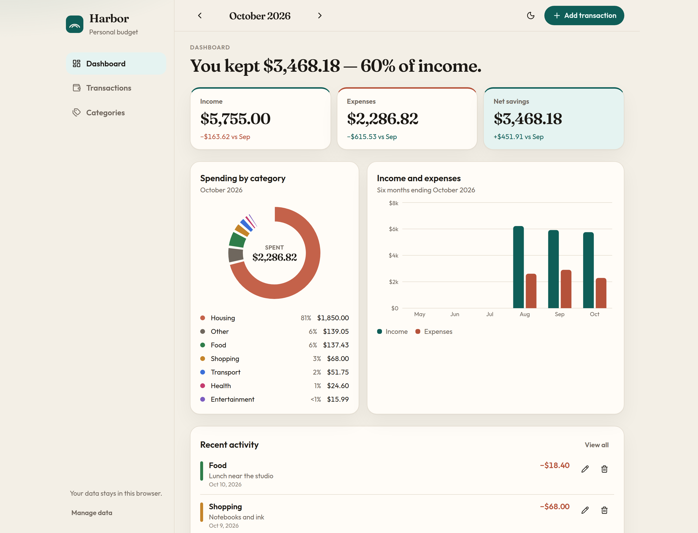

# Harbor

Harbor is a personal budget tracker. It shows what came in, what went out, and what you kept — month by month — without an account or a server.

Amounts are stored in this browser and displayed in US dollars. The first visit opens with three months of sample activity so the dashboard is already readable. You can replace that with your own entries, restore the sample, or clear everything.



## Features

- **Dashboard.** Total income, total expenses, and net savings for the selected month, with a comparison to the month before. A donut chart breaks spending down by category. A bar chart compares income and expenses across the six months ending in the month you are viewing.
- **Transactions.** Add, edit, and delete income and expense entries with an amount, category, date, and note. Search notes, categories, and amounts, and filter by type or category.
- **Categories.** Housing, food, transport, entertainment, health, shopping, and other are included, each with a color. Salary, freelance, and other income are included for money coming in. You can add, rename, recolor, and remove your own categories.
- **Month navigation.** Move between months. Totals, charts, and the transaction list follow the month you pick, and you can jump back to the current month.
- **Sample data and reset.** Three months of realistic entries load the first time. Restore that sample or clear every transaction from Categories → Your data. Clearing leaves your categories in place.
- **Light and dark mode.** The choice is remembered in this browser. Layout works on a phone and on a wide screen.

## Tech stack

- [React](https://react.dev/) 19
- [Vite](https://vite.dev/)
- [Tailwind CSS](https://tailwindcss.com/) 4
- [Recharts](https://recharts.org/)
- Browser `localStorage` (no backend)

## Setup

Requires Node.js 20 or newer.

```bash
npm install
npm run dev
```

Open the URL Vite prints, usually [http://localhost:5173](http://localhost:5173).

```bash
npm run build    # typecheck and production build
npm run preview  # serve the production build
```

## Data

Transactions and categories live under the `harbor.budget.v1` key in `localStorage`. The theme lives under `harbor.theme`. Clearing site data in the browser removes the budget.

## Deploy

Harbor is a static Vite app. On Vercel, import the repository and use the Vite preset:

- Build command: `npm run build`
- Output directory: `dist`

No environment variables are required.
